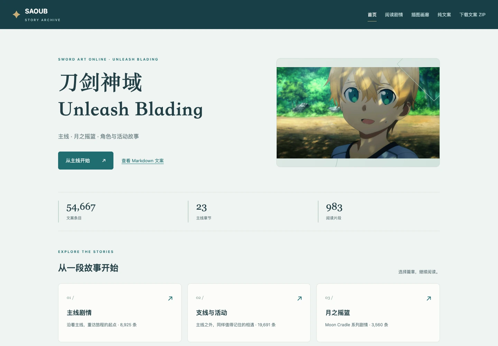
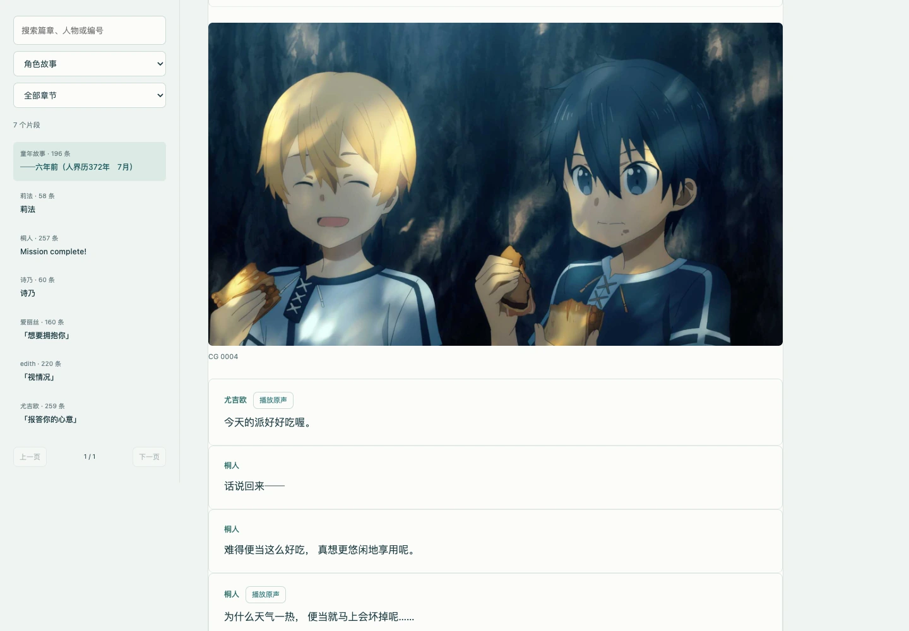
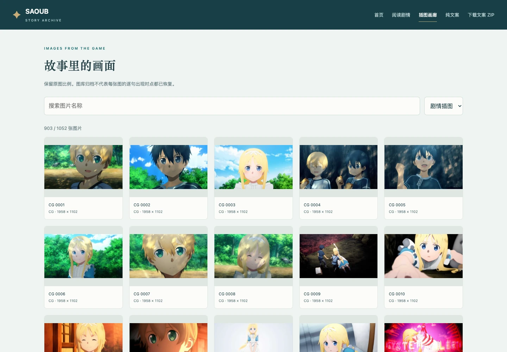

# SAOUB · 剧情阅读档案

主线、支线活动、月之摇篮与角色故事。可在线阅读，也可下载后离线打开，支持原声播放和图片查看。

**[在线阅读](https://arceus-jia.github.io/sao-story-saoub/) · [动画影像](https://arceus-jia.github.io/sao-story-saoub/动画影像.html) · [纯文案目录](https://arceus-jia.github.io/sao-story-saoub/文案目录.html) · [下载纯文案 ZIP](https://arceus-jia.github.io/sao-story-saoub/downloads/sao-story-saoub-texts.zip)**

## 使用方式

### 在线阅读

打开上方网站，选择篇章即可阅读。台词旁的播放按钮可收听原声，点击图片可放大查看。

“动画影像”中可观看或下载游戏原有的视频，支持按名称搜索和类型筛选。

“[插图画廊](https://arceus-jia.github.io/sao-story-saoub/插图画廊.html)”收录4,584张静态图片，可按类型、篇章和资源名称查找。[月之摇篮图片](https://arceus-jia.github.io/sao-story-saoub/插图画廊.html#collection=月之摇篮)单独分组，共用场景另见“UW背景”；角色插画、头像和演出分层分别列出。

只看文字时，可进入“纯文案目录”按章节阅读，也可下载纯文案 ZIP，解压后阅读 Markdown 文本。

### 离线阅读

1. [下载完整网站 ZIP](https://github.com/arceus-jia/sao-story-saoub/archive/refs/heads/main.zip)，并完整解压。
2. 用浏览器打开解压后文件夹内的 `site/index.html`，即可离线阅读、看图、听配音和播放视频。

请保留整个 `site` 文件夹及其同级的 `image-originals` 原图目录，转发时也一起保留。纯文案 ZIP 只含文字，离线看图、听配音需要下载完整仓库。

新增原图保留游戏包内的原始文件，在线放大时从同一GitHub仓库读取；缩略图随网页发布。下载完整仓库后，浏览器使用相对路径读取本地原图，无需联网。

## 页面预览

## 阅读说明

- 黑皇帝篇按前传上下篇、正篇第1～4章和官网后续第5～10章排列。后续页面提供原创导读及日文／英文原文入口，**完整剧本文案来自 SAO 游戏官网 βeater’s cafe 公开剧本**，需联网到官网阅读。
- 部分配音是短句或语气音，并非整句朗读；有播放按钮的台词才可收听原声。
- 图片补充覆盖当前包内静态图片表中可定位的资源，合并1份字节相同的重复图，排除1份空白占位图；不代表游戏历史资源全部齐全。
- 角色插画为现成静态图；Spine对话立绘尚未合成，分片图集不作为完整立绘展示。
- 收录范围以现有游戏资源为准，页面未复原原游戏的完整动画与镜头演出。

## 同系列档案

- [加速世界 vs 刀剑神域](https://arceus-jia.github.io/sao-story-accel-vs-sao/)
- [零境交错](https://arceus-jia.github.io/sao-story-crossing-void/)
- [SAO Memory Defrag](https://arceus-jia.github.io/sao-story-saomd/)

## 内容归属

非官方的个人阅读整理项目，与游戏开发商、发行商无关联。游戏文字、图片和原声的权利归原权利人；本仓库没有为这些内容附加开源授权。请勿将其当作官方版本或用于商业用途。
